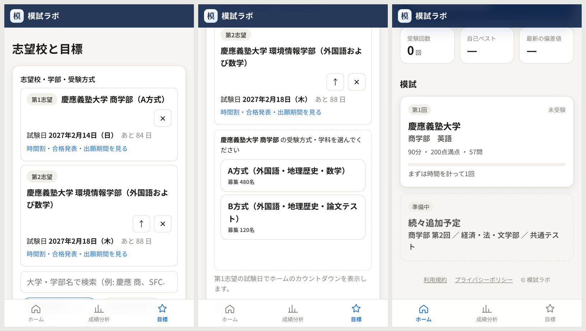
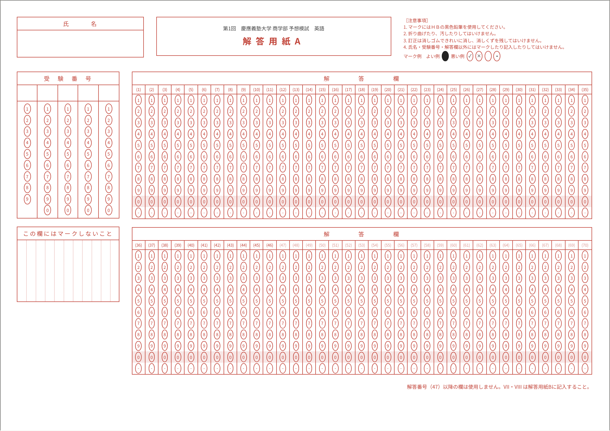
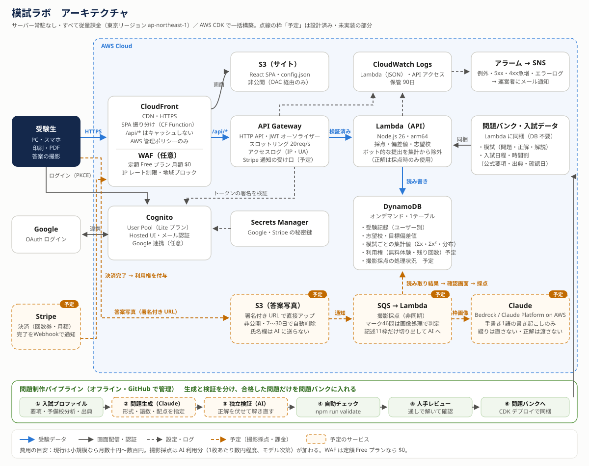

# japan-univ-moshi-lab（模試ラボ）

大学入試の予想模試を、大学・学部ごとに本番と同じ形式のオリジナル問題で作り、Web受験・印刷・成績分析までできるアプリです。

第1弾は **慶應義塾大学 商学部 英語**（90分・200点、大問 I〜VIII、マーク46問＋記述11問）。

> 本模試の問題は過去の出題形式を参考に独自に作成したもので、慶應義塾大学および同大学の入学試験とは一切関係がありません。過去問の本文・設問は使用していません。

## 出題形式の根拠

模試の形式は、次の資料で確認した2020〜2026年度の出題に合わせています（確認日 2026-11-22）。公開問題は形式の確認だけに使い、本文・設問は転用していません（大学は二次利用に著作権許諾が必要と明記）。

| 項目 | 本番（資料） | この模試 |
|---|---|---|
| 試験時間・配点 | 90分・200点（[2027年度 一般選抜要項](https://www.keio.ac.jp/fixed-files/2027_ippan_youkou.pdf)） | 同じ |
| 大問構成 | 8題。I〜III 長文、IV 文法・語法、V 中文空所補充、VI 短文の内容一致、VII・VIII 記述（河合塾 2025・2026年度 分析） | 同じ |
| 長文の分量 | I〜III の総語数 2,358語（2026年度）、2,361語（2025年度） | 2,345語 |
| 長文の設問 | 29問（空所補充10・下線部内容説明10・内容一致7・表題2、2026年度） | 同じ内訳 |
| マーク式の設問数 | 46問（2024〜2026年度） | 46問・すべて4択 |
| VII | 与えられた動詞6つを、時制・態・文構造に合わせて語形変化して補充 | 同じ形式 |
| VIII | 与えられた動詞5つを名詞形にして補充（単数・複数に注意） | 同じ形式 |
| マーク解答用紙 | 解答番号を横に並べ、各列に 1〜9・0・− の楕円（要項の「解答用紙の様式（見本）」） | 同じ様式で印刷 |
| 書式 | 大学が公開している[2026年度の入試問題](https://www.keio.ac.jp/ja/admissions/faculty/examinations/general-admissions/question-2026/)で確認：長文は (i) 空所の設問 → (ii) その他の設問の順に番号、各設問に「The answer is: [ n ]」、選択肢は 1〜4、VII・VIII は解答用紙B・同じ動詞を二回以上選ぶと得点にならない | 同じ書式（採点も同じ規則） |

- 配点の内訳は大学が公表していないため、予備校の想定配点を参考にした本模試独自の配点です（長文の空所3点・その他の長文設問5点、文法2点、中文空所2点、短文4点、記述3点）。
- 赤本（教学社 2027年版、2022〜2026年度収録）は目次まで公開情報で確認しました。「傾向と対策」の本文は書籍で確認してください。

## できること

| 機能 | 内容 |
|---|---|
| ログイン | Google ログイン / メール＋パスワード（Amazon Cognito）。ローカル開発時はダミーログイン |
| 志望校の設定 | 「慶應 商」「SFC」「けいおう」などで検索 → 方式を選ぶだけ。試験日・集合時刻・時間割・配点・合格発表・出願期間を公式要項のデータから自動表示し、公式サイトへリンク（慶應全10学部・共通テスト） |
| Web受験 | 90分タイマー、大問タブ、本文の空所（記述の (a)〜 も含む）をタップすると該当設問へ移動、解答を端末に自動保存（中断・再開可） |
| スマホ対応 | 本文／設問の切替表示、44px以上のタップ領域、ダークモード |
| 印刷・PDF | 表紙、問題冊子（明朝＋Times系の書体、ページ番号）、**解答用紙A（マークシート、横向き・大学の様式見本準拠）**、**解答用紙B（記述）**。A4／B5 |
| 紙で受験 | 印刷して解いた答えを入力して採点 |
| 採点・解説 | 大問別・分野別の得点、全問の正誤と解説、解答・解説冊子の印刷 |
| 偏差値 | 全ユーザーの**初回受験**を母集団として、偏差値・推定順位・得点分布を表示。30人未満は「参考値」 |
| 目標・やる気 | 第1志望の試験日までのカウントダウン、直近の出願期間、目標偏差値までの残り点数、自己ベスト・前回比、伸びしろ（失点の大きい分野） |
| 規約 | 利用規約・プライバシーポリシーの雛形（未成年の利用を考慮。公開前に専門家の確認が必要） |

サンプル: [問題冊子＋解答用紙 PDF (A4)](docs/samples/keio-shogaku-eigo-01-A4.pdf) ／ [解答・解説 PDF](docs/samples/keio-shogaku-eigo-01-answers.pdf)






## 構成（AWS・低コスト）



- サーバー常駐なし（すべて従量課金）。小規模（〜数千ユーザー）なら月数十円〜数百円程度が目安です。Google ログインを使う場合は Secrets Manager（1シークレット月 $0.40）が加わります。
- Lambda は **Node.js 26**（Active LTS、Lambda のサポートは 2029年4月まで）、arm64。
- 偏差値は DynamoDB の集計レコード（人数・Σx・Σx²・10点刻みヒストグラム）を原子的に加算して算出します。「初回受験の記録」と「集計への加算」は1つのトランザクションです。
- 正解・解説は提出前のクライアントには送りません。採点はサーバー側で行います。
- CloudFront は AWS 管理のポリシーだけで構成しています（API は CachingDisabled＋AllViewerExceptHostHeader で Authorization を転送）。CSP は本番ビルドの `index.html` の meta タグで指定します。

### ログ・エラー通知

- Lambda のログ（JSON 形式）と API のアクセスログ（IP・UA・ステータス）を **90日** 保管します。
- 次の場合に CloudWatch アラーム → SNS → **メール** で通知します：Lambda の例外・スロットリング、API の 5xx、4xx の急増（ボットの可能性）、アプリのエラーログ。

### ボット・不正アクセス対策

| 層 | 内容 | 費用 |
|---|---|---|
| アプリ | 24時間あたりの提出回数の上限（20回）。所要15分未満・解答3割未満の提出は偏差値の母集団に入れない（初回の枠も消費しない） | 0円 |
| API Gateway | スロットリング（バースト50・毎秒20） | 0円 |
| CloudFront 定額 **Free プラン**（任意） | WAF（ルール5個）、IP 単位のレート制限、地域ブロック、DDoS 対策込み。デプロイ後にコンソールから加入 | **月額 $0** |

- Free プランは「AWS 無料利用枠を利用中のアカウント」は加入できません。Bot Control（一般的なボットの判定）は Business プラン（月 $200）以上で、小規模なうちは不要と判断しています。
- Free プランに加入するには、CloudFront コンソール → 対象のディストリビューション → 料金プラン → Free を選び、作成される WAF で「IP ベースのレート制限」を有効にします（例: 5分間に 300 リクエスト）。

### API Gateway をなくす選択肢（Lambda Web Functions）

2026年10月に発表された Lambda Web Functions（東京リージョン対応、Node.js 24/26）は、Lambda 自体が HTTPS エンドポイントを持つため API Gateway が不要になります。CloudFront の OAC（IamAuth）で前段に置くと、アプリの Authorization ヘッダ（Cognito の JWT）はそのまま関数に届きます（[公式ドキュメント](https://docs.aws.amazon.com/lambda/latest/dg/web-functions-endpoint-access-control.html)）。

現時点では次の理由で HTTP API を使い続けています。
- 料金がリクエスト・アクティブ CPU に加えて「実行環境が存在する間のメモリ」で、待機中も課金される。少量アクセスの場合の実額は要検証。
- CDK は L1（`CfnWebFunction` など）のみで、JWT の検証をアプリ側（例: `aws-jwt-verify`）に移す必要がある。
- 公開直後のサービスなので、実績が出てから移行を判断したい。

移行する場合も、`api/src/app.ts` の `route()` はそのまま使えます（HTTP サーバーから呼ぶ薄いアダプタを足すだけ）。

```
content/exams/*.json        模試データ（本文・設問・正解・解説）
content/index.ts            模試の登録簿
content/admissions.ts       志望校の選択肢と公式の入試日程（出典・確認日つき）
shared/                     型定義・採点・偏差値計算（API と Web で共有）
api/src/                    Lambda ハンドラ / ローカル API サーバ / DynamoDB・メモリのリポジトリ
web/                        React + Vite のフロントエンド
infra/                      AWS CDK スタック
scripts/validate-content.ts 模試・入試日程データの整合性チェック
scripts/build-*.py          模試データの原稿（JSON を生成）
tests/                      採点・偏差値・API のテスト
```

## ローカルで動かす

Node.js 26 を使います（`.nvmrc`）。

```bash
npm install
npm run dev          # API: http://localhost:8787 / Web: http://localhost:5173
```

任意のユーザー名でログインできます（データは `.local-data.json` に保存されます）。

```bash
npm run validate     # 模試・入試日程データのチェック
npm test             # テスト
npm run typecheck
```

npm 12 以降は、依存パッケージのインストールスクリプトを許可したものだけ実行します。このリポジトリでは esbuild のみ許可しています（`package.json` の設定）。

## AWS にデプロイする

前提: AWS CLI の認証設定、Node.js 26。

```bash
npm install
cd infra && npx cdk bootstrap        # 初回のみ（アカウント・リージョンごと）
cd .. && npm run build
cd infra && npx cdk deploy -c domainPrefix=moshi-lab-<任意の英数字> -c alertEmail=<通知を受け取るメールアドレス>
```

- 出力の `SiteUrl` がアプリの URL です。この時点で、メールアドレスでのログインが使えます。
- `alertEmail` に確認メールが届くので、本文のリンクを開いて購読を有効にしてください。メールアドレスは個人情報なので `cdk.json` やリポジトリには書かず、デプロイ時に指定します。

### Google ログインを有効にする

1. Google Cloud Console で OAuth クライアント（種類: ウェブアプリケーション）を作成します。
2. 「承認済みのリダイレクト URI」に、デプロイ出力の `GoogleRedirectUri`（`https://<domainPrefix>.auth.ap-northeast-1.amazoncognito.com/oauth2/idpresponse`）を登録します。
3. クライアントシークレットを Secrets Manager に保存します。
   ```bash
   aws secretsmanager create-secret --name moshi-lab/google-oauth \
     --secret-string '{"clientSecret":"<Google のクライアントシークレット>"}'
   ```
4. クライアント ID を指定して再デプロイします。
   ```bash
   cd infra && npx cdk deploy -c domainPrefix=moshi-lab-xxx -c googleClientId=<クライアントID>.apps.googleusercontent.com -c alertEmail=<メール>
   ```

### ログイン画面のブランディング

現在は Cognito の Lite プラン＋クラシック Hosted UI（ロゴと CSS の一部のみ変更可）です。選択肢:

| 方法 | 見た目の自由度 | 費用（月1万 MAU まで） |
|---|---|---|
| クラシック Hosted UI（現状） | 低（ロゴ・一部 CSS） | 無料 |
| Essentials プラン＋マネージドログイン | 中（ブランディングエディタで色・ロゴ・背景・レイアウト） | 無料（超過分 $0.015/MAU） |
| アプリ内に自前のログイン画面（Amplify Auth 等） | 高（完全に自由） | 無料。ただし実装・保守とセキュリティの責任が増える |

Google ログインが中心なら、アプリの画面から直接 Google に遷移するため Hosted UI はほぼ表示されません。メール登録の画面を整えたい場合は Essentials＋マネージドログインが最小の手間です。

## 志望校データを更新する

`content/admissions.ts` に、大学の要項から試験日・時間割・配点・募集人員・合格発表・出願期間を転記し、`source.checkedAt`（確認日）を更新します。`npm run validate` は、日程がすべて過ぎた年度のデータを警告します。

## 模試を追加する

1. 原稿スクリプト（例: `scripts/build-keio-shogaku-01.py`）か JSON で `content/exams/<id>.json` を作成します。
   - 本文中の空所は `{{b:番号}}`、下線部は `{{u:番号|下線の文字列}}`、記述の空所は `{{w:a}}` と書きます。
   - 短文ごとに本文がある大問は、設問グループに `passage` を、記述の語群は `wordBox` を指定します。
   - `category` が分野別分析の単位になります（`shared/types.ts` の `Category`）。
2. `content/index.ts` に1行追加し、`content/admissions.ts` の該当学部の `mockExamIds` に ID を追加します。
3. `npm run validate` で整合性を確認します。

## 今後の課題

- 問題の品質確認: 第三者が通しで解いて、複数の正解がありうる設問や難易度の偏りがないかを確認する。
- 早稲田大学など他大学の入試日程データ（要項 PDF の取得元の許可が必要）。
- 利用規約・プライバシーポリシーの専門家による確認と、運営者情報の記入（`web/src/pages/LegalPages.tsx`）。
- 「模試ラボ」の商標調査（J-PlatPat）。
- 依存パッケージのバージョン確認・更新の自動化。
