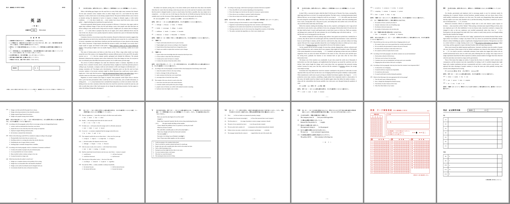
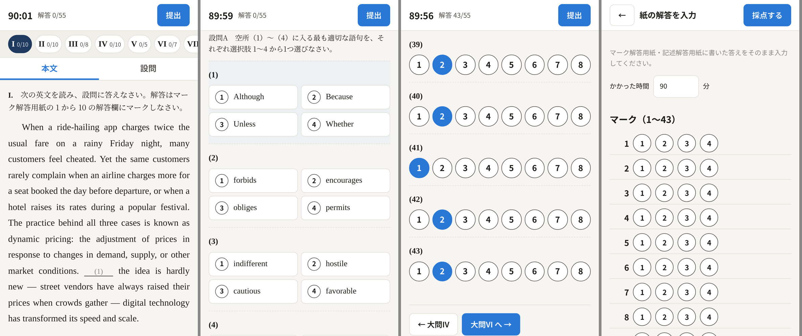

# japan-univ-moshi-lab（予想模試ラボ）

日本の大学入試の予想模試を、大学・学部ごとにオリジナル問題で作成し、Web受験・印刷・成績分析までできるアプリです。

第1弾は **慶應義塾大学 商学部 英語**（90分・200点、大問 I〜VII、マーク43問＋記述12問）。

> 本模試の問題は過去の出題形式を参考に独自に作成したもので、慶應義塾大学および同大学の入学試験とは一切関係がありません。過去問の本文・設問は使用していません。

## できること

| 機能 | 内容 |
|---|---|
| ログイン | Google ログイン / メール＋パスワード（Amazon Cognito）。ローカル開発時はダミーログイン |
| Web受験 | 90分タイマー、大問タブ、本文の空所をタップすると該当設問へ移動、解答を端末に自動保存（中断・再開可） |
| スマホ対応 | 本文／設問の切替表示、44px以上のタップ領域、ダークモード |
| 印刷・PDF | 表紙（注意事項・受験番号欄）、問題冊子（明朝＋Times系の書体、ページ番号）、**マーク解答用紙**（受験番号マーク欄・1〜9の楕円）、**記述解答用紙**。A4／B5を選べる |
| 紙で受験 | 印刷して解いた答えを一覧画面で入力して採点 |
| 採点・解説 | 大問別・分野別の得点、全問の正誤と解説、解答・解説冊子の印刷 |
| 偏差値 | 全ユーザーの**初回受験**を母集団として、偏差値・推定順位（上位%）・得点分布を表示。30人未満のときは「参考値」と明示 |
| 成績分析 | 得点率の推移、分野別の累計得点率、苦手分野と対策の表示 |

サンプル: [問題冊子＋解答用紙 PDF (A4)](docs/samples/keio-shogaku-eigo-01-A4.pdf) ／ [解答・解説 PDF](docs/samples/keio-shogaku-eigo-01-answers.pdf)




## 構成（AWS・低コスト）

```
ブラウザ ─ CloudFront ─┬─ S3（React SPA）
                       └─ /api/* → API Gateway HTTP API（Cognito JWT 認証）→ Lambda（Node 22, arm64）→ DynamoDB（オンデマンド）
認証: Cognito User Pool（Lite プラン）+ Hosted UI（Google / メール）
```

- サーバー常駐なし（すべて従量課金）。小規模（〜数千ユーザー）なら月数十円〜数百円程度が目安です。Google ログインを使う場合は、Secrets Manager の料金（1シークレット月 $0.40）が加わります。
- 偏差値は DynamoDB の集計レコード（人数・Σx・Σx²・10点刻みヒストグラム）を原子的に加算して算出するため、全件スキャンは不要です。
- 正解・解説は提出前のクライアントには送りません。採点はサーバー側で行います。

```
content/exams/*.json   模試データ（本文・設問・正解・解説）
content/index.ts       模試の登録簿
shared/                型定義・採点・偏差値計算（API と Web で共有）
api/src/               Lambda ハンドラ / ローカル API サーバ / DynamoDB・メモリのリポジトリ
web/                   React + Vite のフロントエンド
infra/                 AWS CDK スタック
scripts/validate-content.ts  模試データの整合性チェック（番号の連番・配点合計・正解の範囲など）
tests/                 採点・偏差値・API のテスト
```

## ローカルで動かす

```bash
npm install
npm run dev          # API: http://localhost:8787 / Web: http://localhost:5173
```

任意のユーザー名でログインできます（データは `.local-data.json` に保存されます）。

```bash
npm run validate     # 模試データのチェック
npm test             # テスト
npm run typecheck
```

## AWS にデプロイする

前提: AWS CLI の認証設定、Node.js 22。

```bash
npm install
cd infra && npx cdk bootstrap        # 初回のみ（アカウント・リージョンごと）
cd .. && npm run build
cd infra && npx cdk deploy -c domainPrefix=moshi-lab-<任意の英数字>
```

出力の `SiteUrl` がアプリの URL です。この時点で、メールアドレスでのログインが使えます。

### Google ログインを有効にする

1. Google Cloud Console で OAuth クライアント（種類: ウェブアプリケーション）を作成します。
2. 「承認済みのリダイレクト URI」に、デプロイ出力の `GoogleRedirectUri`（`https://<domainPrefix>.auth.ap-northeast-1.amazoncognito.com/oauth2/idpresponse`）を登録します。
3. クライアントシークレットを Secrets Manager に保存します。
   ```bash
   aws secretsmanager create-secret --name moshi-lab/google-oauth \
     --secret-string '{"clientSecret":"<Google のクライアントシークレット>"}'
   ```
4. クライアント ID を指定して再デプロイします。
   ```bash
   cd infra && npx cdk deploy -c domainPrefix=moshi-lab-xxx -c googleClientId=<クライアントID>.apps.googleusercontent.com
   ```

## 模試を追加する

1. `content/exams/<id>.json` を作成します（形式は既存ファイルを参照）。
   - 本文中の空所は `{{b:番号}}`、下線部は `{{u:番号|下線の文字列}}` と書きます。
   - `category` が分野別分析の単位になります（`shared/types.ts` の `Category`）。
2. `content/index.ts` に1行追加します。
3. `npm run validate` で整合性を確認します。

## 今後の課題

- 出題形式は一般に知られている傾向を元にしています。最新年度の過去問（赤本など）と突き合わせ、大問構成・語数・設問形式を調整してください。
- 問題の品質確認: 第三者が通しで解いて、複数の正解がありうる設問や難易度の偏りがないかを確認してください。
- AI による問題生成パイプライン（出題仕様 → 生成 → 別モデルで解答・検証 → 人手レビュー）は未実装です。
- 偏差値は受験者が増えるほど安定します（30人未満は参考値）。
